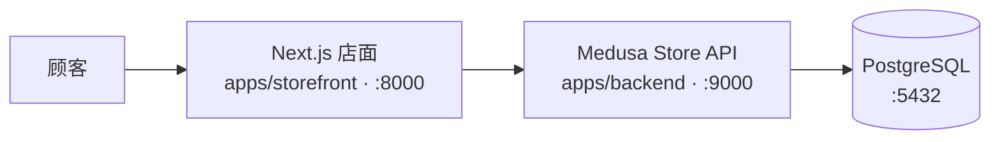

# 实验02 开源在线商城系统二次开发 — README

> 本文档按实验指导书第 16 节对 README 的要求组织为 12 项内容，支持任何机器按本文冷启动、停止与清理。
> 个人证据类信息（姓名、学号、Git 仓库地址、实测数据、Commit SHA、截图路径）以【待补充】占位，完成实验后替换。

---

## 1. 项目简介

本项目在 Medusa 2.20.1 与官方店面模板 DTC Starter 的固定基线上完成二次开发，跑通「商品浏览 → 搜索 → 详情 → 购物车 → 结算 → 创建订单」完整电商状态链，并自主扩展了**登录用户收藏夹**功能。开发遵循"复用框架扩展点、不修改依赖包源码"的原则。



三条主链路：

- 浏览 / 搜索商品：`GET /store/products`、`GET /store/products?q=`
- 购物车：创建购物车 → 加入变体 → 修改数量
- 结算：填写配送与支付 → `POST /store/carts/{id}/complete` 创建订单（幂等）

## 2. 功能范围

- **必做主链路**：商品列表、搜索、详情、加入购物车、修改数量、填写结算、创建订单、管理端查询订单。
- **自主功能（用户收藏夹）**：
  - `POST /store/wishlist/items`　收藏商品（登录态）
  - `DELETE /store/wishlist/items/{id}`　取消收藏
  - `GET /store/wishlist`　查询收藏列表（含可售标记）
  - 规则：未登录 401；参数缺失 400；商品不存在 404；重复收藏幂等返回既有记录；商品下架保留条目并返回可售标记；收藏不预留库存，库存由结算校验。
- **非功能要求**：固定版本可复现、结算幂等、前端不伪造下单成功、证据（截图 / 录屏 / 日志）随仓库提交。

## 3. 技术栈与固定版本

| 组件 | 版本 / 值 | 说明 |
|---|---|---|
| 基线 Commit | `19e8a6fbefea5a385e9502409908bfbebbecf526` | DTC Starter 快照，锁定上游 |
| Medusa | 2.20.1 | 后端核心框架（MIT 许可） |
| pnpm | 10.11.1 | 按锁文件安装依赖 |
| Node.js | 24 LTS | 后端、店面运行环境 |
| PostgreSQL | 16.x（≥15） | 数据持久化 |
| Git | 2.40+ | 分支与提交管理 |

## 4. 目录结构

```text
├── apps/
│   ├── backend/        # Medusa 后端（:9000，含管理端 /app）
│   └── storefront/     # Next.js 店面（:8000）
├── src/
│   ├── api/store/wishlist/   # 收藏夹自定义 Store API 路由（新增）
│   ├── modules/wishlist/     # 收藏夹模块与数据模型（新增）
│   └── workflows/            # 结算等工作流（基线自带）
├── tests/              # API 与边界自动化测试（新增）
└── package.json        # 依赖与脚本
```

## 5. 环境要求

- Windows 11 / macOS / Linux（受支持版本）
- Node.js 24 LTS、pnpm 10.11.1
- PostgreSQL 16.x（至少 15）
- Git 2.40+

## 6. 安装与依赖安装

```bash
# 克隆仓库并固定到基线提交
git clone https://github.com/L1nbd/medusa-store-exp02.git
cd medusa-store-exp02
git checkout 19e8a6fbefea5a385e9502409908bfbebbecf526

# 按锁文件安装依赖（不要混装最新版本）
pnpm install
```

## 7. 环境配置

后端（`apps/backend/.env`）：

- 创建仅用于实验的 PostgreSQL 数据库与账号，配置真实 `DATABASE_URL`
- 替换默认 JWT 密钥与 Cookie Secret（本地随机生成）
- 收紧本地 CORS；支付使用测试支付 `pp_system_default`，配送使用手工 provider（不配置真实支付密钥）

店面（`apps/storefront/.env`）：

- 设置 `NEXT_PUBLIC_MEDUSA_BACKEND_URL=http://localhost:9000` 与 Publishable API Key
- 区域使用 Store 默认区域 `dk`（不可直接改为 `cn`）

## 8. 数据库初始化与种子数据

```bash
pnpm exec medusa db:migrate                # 执行迁移
pnpm exec medusa user -e admin@example.test -p "【本地随机密码】"   # 创建本地管理员
```

- 核对种子脚本 `initial-data-seed.ts` 是否已执行
- 准备至少 10 个虚构商品，覆盖多变体、零库存、仅剩 1 件与长标题等边界

## 9. 启动与访问

```bash
pnpm run dev            # 同时启动后端与店面（或在 apps 目录分别启动）
```

| 服务 | 地址 |
|---|---|
| 后端健康检查 | http://localhost:9000/health |
| 管理端 | http://localhost:9000/app |
| 店面 | http://localhost:8000/dk/store |

## 10. 测试运行

测试配额：**E2E 8 项 + API 6 项 + 边界 6 项 + 持久化 2 项 = 22 项**（编号 T01–T08 / A01–A06 / B01–B06 / P01–P02，完整清单与预期见实验报告第 5 节与表 2）。

```bash
# API 与边界测试（自动化）
pnpm exec medusa test  <测试命令【待补充】>
```

- API 与边界测试优先以自动化测试文件运行；E2E 结合浏览器操作记录
- 保留测试证据：主链路请求 / 响应摘要与订单编号、自动化测试输出、失败前后对比、重建日志、截图 / 录屏【待实验补充】

## 11. 停止与清理

```bash
# 停止后端与店面（前台 Ctrl+C 或结束对应进程）
# 如需彻底重置（谨慎，会删除实验数据）：
#   1) 停止 pnpm dev
#   2) 删除实验数据库并重建空库
#   3) 重新执行第 8 节迁移与种子流程
```

清理策略：购物车标识保存在受控客户端存储，删除浏览器站点数据即可重置店面侧状态；仓库内不需要提交 `.env` 与本地数据库文件。

## 12. 许可证与声明

- 上游：Medusa 与 DTC Starter 均为 **MIT 许可**开源项目；本实验基于其固定快照二次开发，改动仅落在应用层（`src/api`、`src/modules`、店面页面与文档）。
- 不修改 `node_modules` 依赖包源码；升级上游时冲突面可控。
- 本仓库为课程实验用途，包含占位符信息（姓名、学号、Commit SHA、测试数据），提交前请完成替换。
- 配套材料：实验报告（含附录 A Store API 调用摘要、附录 B 收藏夹业务规则决策记录、附录 C Git 提交与 PR 证据对照表）与课堂展示 PPT。
